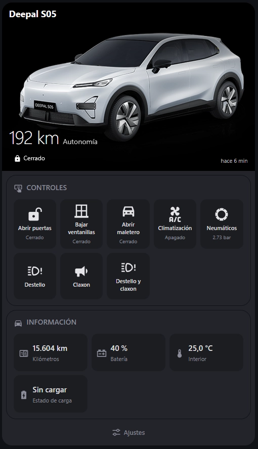
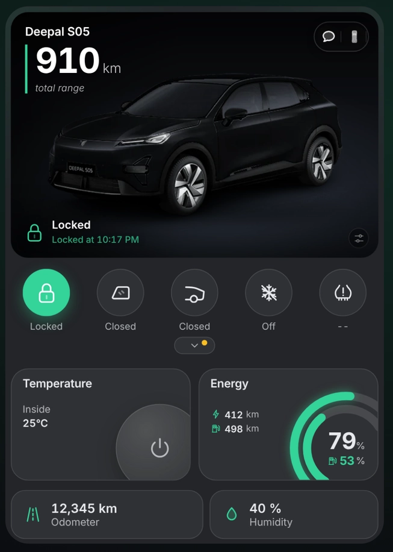
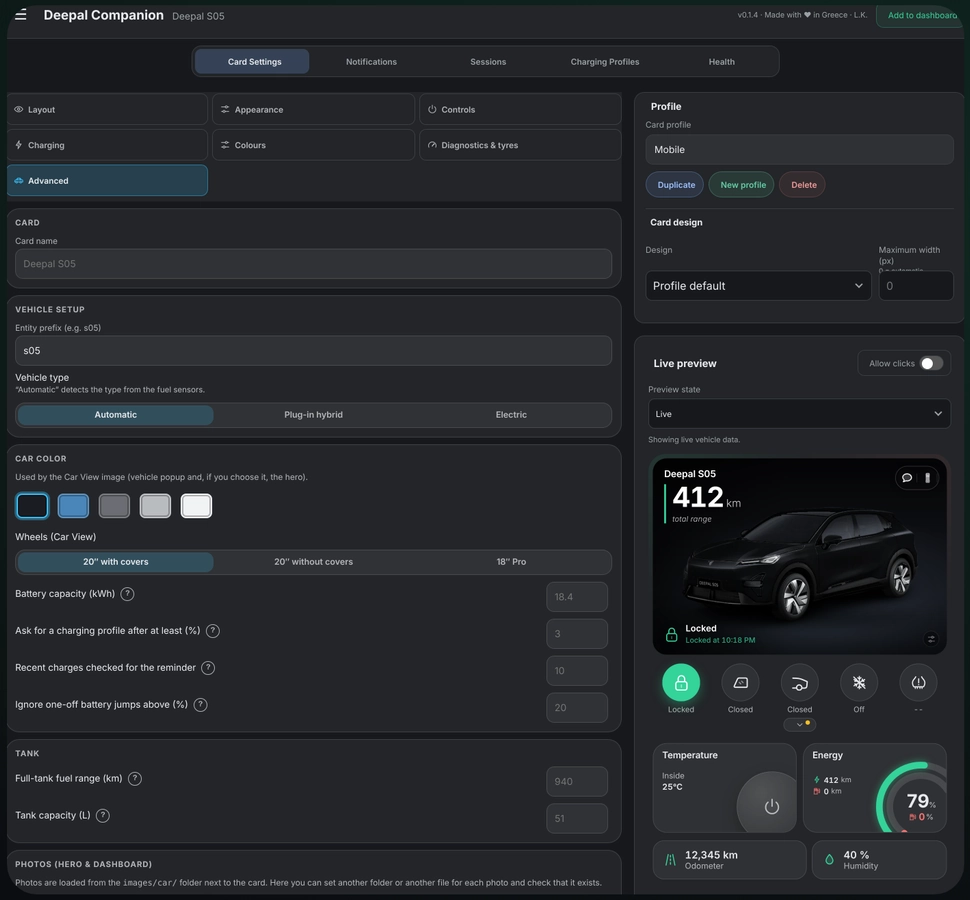

# Changan Deepal vehicles integration for Home Assistant

Home Assistant custom integration for **My Changan / Deepal** connected vehicles (S05, S07, E07) over the official international and chinese API.

The integration provides the connection, the telemetry and the remote controls; the look comes from a dashboard card. It ships a built-in card for every model, and **Deepal S05 owners get the best result with the community Deepal Companion dashboard** (see [Dashboards and cards](#dashboards-and-cards)).

## Important warnings

- Unofficial project, not affiliated with Changan Automobile. Use it at your own risk.
- Remote commands act on the real vehicle. Make sure it is safe before using locks, windows, trunk,
  climate, lights or horn.
- Signing in with an account can sign that account out of the official My Changan app, and signing
  in to the app again can invalidate the Home Assistant session. Use a **secondary account** shared
  from your main account to avoid this (see below).

## Requirements

- Home Assistant 2026.8.0.
- An international My Changan account (email or SMS login). The HACS metadata advertises the
  countries with a translated language: Spain, Portugal, the United Kingdom, Ireland, France,
  Belgium, Luxembourg, Germany, Austria, Switzerland, Italy and Greece.

## Supported vehicles

The integration talks to the official international My Changan platform and targets the European
models; Chinese SDA accounts can also be configured by pasting an access token.

| Model | Notes |
| --- | --- |
| S05 EV / S05 PHEV | Telemetry and signed remote controls over MQTT and the REST API. |
| S07 | Not tested. Telemetry and signed remote controls through the REST API. |
| E07 | Only tested on SDA API. Telemetry through the REST API. |

## Supported features

### Authentication and session

- Email-code and SMS-code login on the international platform, with automatic token refresh and a
  reauthentication flow. If a verification code does not arrive, the login step can resend it or
  correct the destination; Changan is currently not delivering SMS codes, so the email method is
  recommended.
- Integration options for the scan interval, API logging and the regional environment.

### Telemetry

- REST telemetry: battery and range, charging state and currents, remaining charge time, charge
  limit (only in some vehicles), charge schedule and plan, doors, windows, climate, seats, tires and
  lamps.
- MQTT telemetry for MQTT-backed vehicles (S05) through the CA gateway, including the mileage
  fields, the dashboard warning lights (12 V battery, tire pressure, ABS, airbag, brake fluid,
  brakes, power steering, power limit, power system, traction battery low and coolant
  temperature), the key fob battery, the air recirculation state and the rear fog lamp.
- Beta MQTT telemetry for SDA-platform vehicles (`SDA-MQTT`, E07) through the SDA condition
  service, with fallback to the legacy service and the REST condition.
- Climate target temperature, outside temperature (when the vehicle reports it), fan level, the
  license plate and per-window opening-degree sensors (the opening sensors ship disabled by default
  because the scale is not confirmed).
- Fuel telemetry on PHEV/range-extender vehicles (fuel level, fuel range and tank capacity).
- **Opt-in vehicle location**: enable *Fetch the vehicle location* in the options to request and
  expose the car position as a device tracker. **European vehicles currently report no location**, so
  the tracker may stay unknown.
- One Home Assistant device per vehicle, with translated entity names.

### Vehicle wake

- MQTT-backed vehicles (S05) report telemetry only while they are awake. The refresh button wakes a
  sleeping vehicle with the same service the official app uses and waits for a fresh report; wakes
  are throttled per vehicle so Home Assistant cannot drain the 12 V battery, and the periodic poll
  never wakes the car.
- While a charging session is open, the integration reads only the charging vehicles every 10
  minutes and stops as soon as the session closes.
- Waking the vehicle can take up to 20 seconds before it reports again.
- REST-backed and `SDA-MQTT` vehicles keep using the signed condition request; the MQTT wake is only
  available for CA/MQTT vehicles.

### Remote controls

- Signed REST commands: climate, door lock, windows, trunk, charge limit, charge schedule, lights,
  horn and lights-and-horn together.
- Comfort commands: seat heating and ventilation levels and steering-wheel heating.
- The door lock, window and trunk commands require the remote control PIN created with the account
  Home Assistant signs in with; their entities are only created once the PIN is saved in the
  integration options. The PIN is verified against the account when it is saved, so an invalid one,
  or one created with another account, is rejected instead of stored.
- When the car is asleep, the PIN commands wake it first: the first attempt can take up to 20
  seconds while the vehicle wakes up and reports before the command is sent.
- Flashing the lights, sounding the horn and the combined lights-and-horn button make the car run a
  physical cycle (about 30 s, 6 s and 30 s respectively).

### Vehicle image

- One image entity per vehicle: the API picture when it loads, and a bundled per-model render
  (S05, S07, E07 or a generic Deepal placeholder) served instantly otherwise, so the device
  page always shows a picture even when the API image is slow or missing.
- The dashboard card prefers the official per-vehicle layered pack when the integration can
  download and validate it, with the bundled art as a per-category fallback; animations stay on the
  bundled WebM files.


## Dashboards and cards

The integration ships **one configurable card** and nothing else: no sidebar panel, no generated
dashboard strategy and no second compact card. Everything is served by the integration itself, with
no HACS cards, no helpers and no Lovelace resources to configure.

Everything the integration exposes is plain Home Assistant entities, so any dashboard can use it. Two cards are worth knowing:

| | **Bundled card** (`custom:deepal-card`) | **[Deepal Companion](https://github.com/rmxs/deepal-S05-Companion)** |
| --- | --- | --- |
| Where it comes from | Included in this integration, nothing else to install | Separate community integration that runs on top of this one |
| Vehicles | S05, S07, E07 and a generic Deepal profile | Deepal S05 (EV and PHEV) |
| What you get | One configurable card: hero image, sections, action buttons, climate and tyre dialogs, six languages | Full S05 dashboard: state-aware car view, charging sessions, energy and cost history, Live notifications |
| Install | Add the card, it is already served | HACS or Marketplace, then add **Deepal Companion** |
| License | MIT (this repository) | GPL-3.0, maintained by [rmxs](https://github.com/rmxs) |

> **Driving a Deepal S05? [Install Deepal Companion](https://github.com/rmxs/deepal-S05-Companion/tree/main).** It is designed specifically for the S05 and adds the dashboard, the charging archive with costs and the phone notifications, while this integration keeps providing the connection, the telemetry and the remote controls underneath. Install this integration first, then Companion.

### Bundled card: `custom:deepal-card`

<p align="center">
  
</p>

1. **Edit dashboard → Add card** select by card and pick **Deepal vehicle**, then select the car in the visual
   editor (only if you have more than one vehicle). By hand:
   ```yaml
   type: custom:deepal-card
   device_id: <your vehicle device id>
   ```
2. Open the card's **Settings** button (or the visual editor) to choose the vehicle image style
   (plant, isometric, photos or the image entity), the sections and their order, the action buttons,
   the information tiles, the language (automatic, or English, Spanish, German, French, Italian or
   Portuguese) and the card margins. Climate and tyres open dialogs with the controls and the four
   tyre pressures; the charging section appears only while the charger is connected.
3. Settings changed from the card are written to the card YAML when the dashboard is editable and
   the user is an administrator; otherwise they are stored in the Home Assistant user data for that
   card. The lock, windows and trunk controls require the remote control PIN.

The card discovers the vehicle and its entities from the Home Assistant registries, so any name,
area or language works, and the model profiles (S05 EV, S05 PHEV, S07 and generic) only show the
artwork and sections their vehicle exposes. It uses the official per-vehicle image pack when the
integration can download it, with the bundled art as fallback.

### Deepal Companion: the recommended dashboard for the S05

<p align="center">
  
</p>

[**Deepal Companion**](https://github.com/rmxs/deepal-S05-Companion) is an independent community
integration built for the Deepal S05 (EV and PHEV). It reads the same `deepal` entities this
integration creates and adds a complete S05 experience on top of them:

- state-aware car view with paint colours and wheels, and images that reflect doors, windows,
  bonnet, tailgate, lights and charging;
- lock, windows, tailgate, climate, lights, horn and locate controls, plus climate, seats, tyres and
  diagnostics panels;
- automatic charging-session recording, a charging archive with curves, energy history and costs
  with per-location tariffs and charging networks (Spain, Italy and Greece);
- **Live notifications** on the phone Lock Screen for charging, climate and doors left open
  (iPhone Live Activities and Android Live Updates);
- profiles, layouts and a built-in control panel with a live preview of your car.

It is installed as its own integration, separate from this one:

1. Add `https://github.com/rmxs/deepal-S05-Companion` as an **Integration** in HACS (or in
   **Settings > Marketplace > Add from link** on Home Assistant 2026.11 and newer).
2. Install **Deepal Companion** and restart Home Assistant.
3. Open **Settings > Devices & services > Add integration**, search for **Deepal Companion** and
   confirm the detected vehicle.
4. Open **Deepal Companion → Card Settings**, pick a card profile and use **Add to dashboard**.

[installation guide](https://github.com/rmxs/deepal-S05-Companion/blob/main/docs/INSTALLATION.md);
report its issues in its own repository.

### Diagnostics

- Redacted diagnostics download with the mapped telemetry, the raw payloads, the unmapped MQTT
  keys and the per-vehicle capability codes reported by the app backend. Credentials, personal
  identifiers, location values and the device id embedded in MQTT topics are redacted at any
  nesting depth, without distinguishing letter case.
- Optional **full diagnostics capture** with every REST and MQTT exchange, stored as JSONL in
  `/config/deepal_diagnostics/<entry_id>/`. The options form reports the active segment, a signed
  download link and the action selector; files rotate at 10 MB and the five newest are kept. This
  is the artifact to attach to an issue when the standard report is not enough.

## Recommended setup: use a secondary account

Logging in to Home Assistant with your main My Changan account can sign it out of your phone. The
recommended setup is to create a second account, share the vehicle from the main account and use the
secondary account only for Home Assistant:

1. In the My Changan app, create a new account with a different email and note its credentials.
2. Still signed in with your **main** account, open the vehicle, tap **Share** and invite the new
   account.
3. Sign in to the app with the **new** account and accept the shared vehicle control.
4. If you want to control the doors, windows or trunk, create the control PIN with the new account:
   try to lower the windows from the app, it asks you to create a PIN, create it and check that the
   command works. Those commands are signed with the PIN and require it; climate, lights and horn do
   not need it.
5. Sign out of the app and add the integration in Home Assistant with the **new** account. Your main
   account can stay signed in on the phone.

## Installation guide

A complete step-by-step guide (secondary account, HACS install, configuration, remote control PIN and
troubleshooting) is available in every language the integration supports:

- [Español](guides/installation-guide.es.md)
- [English](guides/installation-guide.en.md)
- [Deutsch](guides/installation-guide.de.md)
- [Français](guides/installation-guide.fr.md)
- [Italiano](guides/installation-guide.it.md)
- [Português](guides/installation-guide.pt.md)

## Installation

### HACS

[](https://my.home-assistant.io/redirect/hacs_repository/?owner=Sunek0&repository=ha-deepal-alternative&category=integration)

1. Click the badge (or add this repository as a custom repository of type **Integration**:
   `https://github.com/Sunek0/ha-deepal-alternative`). The badge opens HACS on your instance and
   offers to add the repository as a custom repository.
2. Install **Deepal Alternative** and restart Home Assistant.
3. Add the integration from **Settings > Devices & services**, choose the international platform and
   log in with an email or SMS code (use the secondary account from above).

Updating keeps the same `deepal` domain, so no reconfiguration is needed.

### Manual

1. Copy `custom_components/deepal/` into your Home Assistant `config/custom_components/` directory.
2. Restart Home Assistant and add the integration as described above.

## Configuration

Open **Settings > Devices & services > Deepal Alternative > Configure** to change these options:

- **Remote control PIN**: required for the door lock, window and trunk commands. Use the PIN created
  with the account Home Assistant signs in with (the secondary one); it is verified against the
  account when saved, so a PIN created with another account is rejected before it is stored.
- **Scan interval**, **API logging**, **full diagnostics capture** and **regional environment**:
  polling cadence and troubleshooting helpers. Leave the defaults unless you are debugging. Every
  cycle reads each vehicle over MQTT plus the app condition, so an account with several cars can
  raise the interval (for example to 5 minutes) to make fewer cloud requests.
- **Full diagnostics capture**: writes every REST request/response and MQTT exchange to
  `/config/deepal_diagnostics`, under the integration's **Diagnostics** section in the same options
  form. The option is off by default. The section shows the active file and a signed download link,
  and its action selector can start a new file, delete all files or refresh the link. Deleting
  requires the confirmation checkbox. The files are redacted (tokens, keys, VIN, email, phone, PIN,
  identifiers and location hidden), rotate at 10 MB and keep the five most recent segments. The
  capture grows while it is enabled, so disable it when you have the file; the rotation keeps the
  disk use bounded.

## Automation examples

The examples below use entities the integration creates for every command-capable vehicle. Entity
ids follow your vehicle name, so adjust them before copying (the ones below assume a vehicle named
`Deepal S05`); the examples only call entities the integration provides.

Notify when the car starts charging:

```yaml
automation:
  - alias: "Deepal charging started"
    triggers:
      - trigger: state
        entity_id: binary_sensor.deepal_s05_charging
        from: "off"
        to: "on"
    actions:
      - action: notify.mobile_app_your_phone
        data:
          title: "Deepal"
          message: "Charging started."
```

Lock the doors when the driver door stays unlocked for five minutes:

```yaml
automation:
  - alias: "Deepal doors left unlocked"
    triggers:
      - trigger: state
        entity_id: binary_sensor.deepal_s05_driver_door_unlocked
        to: "on"
        for: "00:05:00"
    actions:
      - action: lock.lock
        target:
          entity_id: lock.deepal_s05_doors
      - action: notify.mobile_app_your_phone
        data:
          title: "Deepal"
          message: "The doors were unlocked; locking them now."
```

## Data and security

- **Secrets at rest.** The integration stores the session tokens, the login private key and the
  remote control PIN inside the Home Assistant config entry (`.storage/core.config_entries`). Home
  Assistant does not encrypt config entries: restrict the permissions of the `.storage` directory
  and keep your backups encrypted.
- **Vehicle image.** The image entity only downloads `https` URLs from the account payload and does
  not follow redirects; when the image cannot be fetched, the bundled asset is shown.
- **Card actions.** The card only reads the integration's entities and calls its services. The
  controls that act on the car require the remote control PIN when one is configured.
- **Secondary account.** Running the integration with a secondary My Changan account limits what
  the stored session can do; see the recommended setup section above.

## Troubleshooting

- **No control can be changed**: check first whether the official app can change it with the same
  account. The car sometimes refuses every remote command until it has been driven for a few
  minutes.
- **"Remote control PIN is not set" although a PIN is configured in Home Assistant**: the PIN was
  not created in the account Home Assistant uses. Sign in to the app with that account, create the
  PIN (step 4 above) and save it again in the integration options.
- **Home Assistant asks to reauthenticate**: the session was invalidated from the app or another
  device. Sign in again; using the secondary account avoids most of these.
- **The login verification code does not arrive**: the login step offers resending the code and
  correcting the email or mobile number without restarting. Changan is currently not delivering SMS
  codes (verified against the official app with the same account), so use the email method.
- **Values look stale**: the vehicle only reports telemetry while it is awake; use the refresh
  button to wake an MQTT-backed car (the first PIN command wakes it too), or the integration shows
  the last known snapshot until the car reports again.
- **Fuel entities are missing on a PHEV**: the integration creates them only when the vehicle's
  function configuration reports `#oilMileage` and the model is not a BEV.
- **The charge-limit control is missing on an S05 PHEV**: the car advertises the capability, but the
  condition never returns the current limit, so the sensor and number are not created until a
  readable source is verified.
- **The coolant warning is missing on an S05 PHEV**: `coolanTemperatureLightStatus` is `1` in every
  report even on a healthy, unplugged car, so the diagnostic entity is not created for that model;
  the raw bit remains in the diagnostics.
- **A telemetry field is missing**: download the diagnostics from the device page and check
  `unmapped_mqtt_keys`; enable debug logging for `deepal_sdk` to see the candidate values in the
  Home Assistant log. Credentials, VIN and location-like values are redacted in the report.
- **SDA vehicle (E07) remote controls or MQTT telemetry misbehave**: remote controls are not
  supported on the SDA platform yet. For telemetry or MQTT reports, the release ships two helpers
  under [`tools/`](tools): the [`sda-mqtt-probe`](tools/sda-mqtt-probe) runs on your computer with no
  phone setup and reports how the broker session works, and the
  [`sda-mqtt-capture`](tools/sda-mqtt-capture) kit decodes the official app's MQTT frames locally
  (secrets, plate and location are masked in the logs they produce). Neither is part of the HACS
  install.

## Removal

1. Open **Settings > Devices & services**, select **Deepal Alternative** and delete the integration
   entry. This removes the vehicle devices and their entities and deletes the stored charging
   sessions; for international entries the integration also asks the server to log the session out
   (best effort: a failure never blocks the removal).
2. Remove the files: with HACS, remove the **Deepal Alternative** repository from HACS; with a
   manual install, delete the `custom_components/deepal` directory from your configuration.
3. Restart Home Assistant.

## Credits

The charging-session tracking follows the approach of
[DEC Deepal](https://github.com/manuelem1984/dec_deepal) (MIT), which documents the same session
rules.

[Deepal Companion](https://github.com/rmxs/deepal-S05-Companion) is a separate community project by
[rmxs](https://github.com/rmxs) (GPL-3.0) that builds its dashboard on the entities of this
integration.

## Disclaimer

Unofficial project, not affiliated with Changan Automobile. Use at your own risk.
